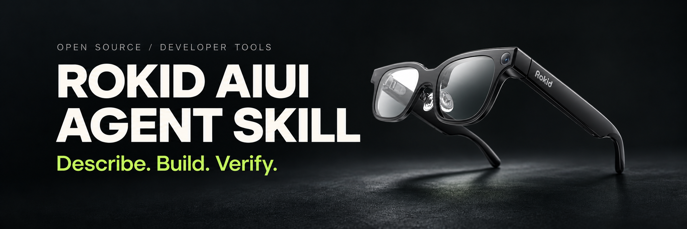
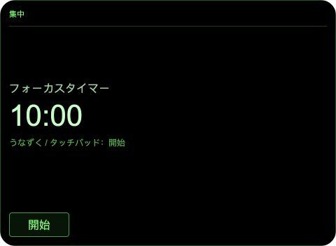
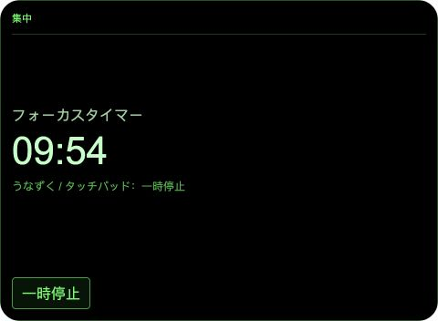
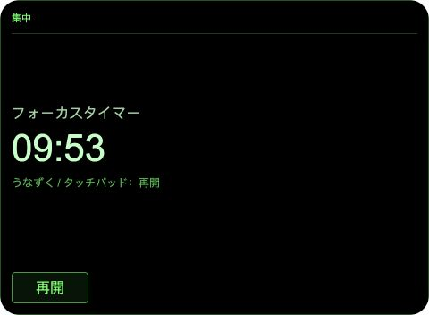

<p align="center">
  <a href="README.md">简体中文</a> · <strong>English</strong> · <a href="README.ja.md">日本語</a><br>
  Usage guides: <a href="docs/usage.zh-CN.md">中文</a> · <a href="docs/usage.en.md">English</a> · <a href="docs/usage.ja.md">日本語</a>
</p>

<div align="center">

[](https://github.com/BreezeLife/rokid-aiui-agent-skill/actions/workflows/ci.yml) [](LICENSE) [](skills/rokid-aiui-agent/references/aiui-0.19.md)

</div>

# ROKID AIUI Agent Skill

**From a plain-language request to a complete Agent you can import into AIUI Studio.**

This community-maintained, open-source Agent Skill helps coding tools such as **Codex, Claude Code, and Cursor** develop for ROKID AIUI. Describe what you need, and your tool creates editable source, checks functionality and interaction, and prepares submission materials.

Install the Skill in your coding tool to create new Agents or review, debug, and extend existing projects. It brings together version-matched references, project validation scripts, and complete examples to help you check whether APIs actually execute, whether their results are useful, and which checks still require Studio or the target glasses.

New projects default to **AIUI 0.19.0**. The bundled Japanese Focus Timer stays on **0.17.0** for compatibility regression testing. The source is licensed under **Apache-2.0** and is open to inspection, modification, and extension.

[Getting started](#getting-started) · [Prerequisites](#prerequisites) · [Web and desktop setup (Chinese)](docs/web-and-desktop.zh-CN.md) · [Example](#bundled-focus-timer) · [Verification scope](#automated-checks)

## What the Skill can do

Ask your coding tool to use it for these tasks:

- Create a complete, editable AIUI project
- Modify or extend an existing AIUI project
- Configure [`app.json` pages, permissions, and entry points](skills/rokid-aiui-agent/references/project-anatomy.md#configure-appjson-from-actual-features), selecting permissions for the features actually implemented
- Adapt community camera, model, and speech patterns while checking cancellation, retries, repeated input, and real data flow; see the [practical guide](skills/rokid-aiui-agent/references/community-patterns.md)
- Review and debug AIUI code, interactions, and version compatibility
- Validate and deliver source that AIUI Studio can import, plus an `.aix` package when packaging requirements are met
- Check functionality and UX, and prepare Agent descriptions, permission explanations, and review materials

## Prerequisites

*Prepare the environment for the work you plan to do.*

| Task | Requirements |
| --- | --- |
| Use the Skill in a coding tool | A tool that supports Agent Skills, an active account, and access to read the Skill and edit project files; local checks also require terminal access |
| Install with the `npx skills` commands below | **Node.js ≥22.20.0** and npm / npx; see the [Skills CLI requirements](https://github.com/vercel-labs/skills#install-a-skill) |
| Run the bundled project checks | **Python 3.12** is recommended to match this repository's CI; the core structure, fingerprint, and capability inventory scripts use the standard library |
| Preview and package locally | Optional **AIX CLI**; this repository pins `0.8.2`, which requires Node.js ≥20. Run `aix --help` first and use only supported commands |
| Complete Studio / device acceptance | An authorized **AIUI Studio** account; target **Rokid Glasses** for device behavior checks |

For web and desktop apps, follow the relevant setup in the [dedicated guide (Chinese)](docs/web-and-desktop.zh-CN.md). Record checks as `BLOCKED` when the required tool, account, or device is unavailable.

To maintain this repository or run its full test suite, also install the development dependencies in the [verification steps](docs/usage.en.md#5-check-the-delivered-project). CI uses Node `24.19.0` and Python `3.12`.

## Choose your environment

Use a web app, desktop app, or CLI. Install or open your tool first, then add this Skill; installing the app does not install the Skill automatically.

| Environment | How to begin | Setup instructions |
| --- | --- | --- |
| Codex web | Create a Codex Cloud environment in ChatGPT and add the Skill to the cloud project's repository | [Web and cloud setup (Chinese)](docs/web-and-desktop.zh-CN.md#codex-web) |
| Claude web | Upload and enable the complete Skill ZIP under Customize → Skills | [Web upload steps (Chinese)](docs/web-and-desktop.zh-CN.md#claude-web) |
| Codex desktop app | Download the ChatGPT desktop app, select Codex, and add the Skill with the built-in installer | [Download, install, and invoke (Chinese)](docs/web-and-desktop.zh-CN.md#codex-desktop) |
| Claude desktop app | Download Claude, select Code to open a local project, and add the Skill | [Download, install, and invoke (Chinese)](docs/web-and-desktop.zh-CN.md#claude-desktop) |
| CLI / IDE | Install with the Skills CLI in a terminal, then invoke it in your coding tool | [Five-step workflow below](#route-2-develop-with-codex-or-another-vibe-coding-tool) |

If you prefer to avoid the terminal, follow the desktop app guide. For browser-only work, use the Codex Cloud or Claude web instructions. A locally installed Skill does not automatically become available to every web task.

## Getting started

*Choose a route and build your first verifiable AIUI project.*

Choose route 1 to open an existing project or try the example. Choose route 2 to develop with an AI coding tool. The installation commands and first development prompt are ready to copy below.

### Route 1: Open a project in AIUI Studio

Follow [Import into AIUI Studio](#import-into-aiui-studio) to open a complete local or GitHub project, then continue editing and developing in Studio.

If you do not have a project yet, start with the [bundled Focus Timer](#bundled-focus-timer).

### Route 2: Develop with Codex or another Vibe Coding tool

The steps below use Codex CLI / IDE installation as an example. Other coding tools that support Agent Skills work too. Check the [prerequisites](#prerequisites) first. Desktop app users can install through the guide above and reuse the same development prompt.

1. Install the Skill. Run these recommended commands in your coding environment's terminal to install it for the current user and check the result:

   ```bash
   npx skills add BreezeLife/rokid-aiui-agent-skill --skill rokid-aiui-agent --agent codex --global
   npx skills list --agent codex --global
   ```

   The list should include `rokid-aiui-agent`. For Claude Code or Cursor, replace `codex` in both commands with the value below. `--global` lets projects share the Skill and keeps Skill files outside the AIUI import directory.

   | Tool | `--agent` value | Invoke in chat |
   | --- | --- | --- |
   | Codex | `codex` | Enter `$rokid-aiui-agent`; [official guide](https://learn.chatgpt.com/docs/build-skills#how-chatgpt-and-codex-use-skills) |
   | Claude Code | `claude-code` | Enter `/rokid-aiui-agent`; [official guide](https://code.claude.com/docs/en/skills) |
   | Cursor | `cursor` | Enter `/`, then search for and select `rokid-aiui-agent`; [official guide](https://cursor.com/docs/skills#how-skills-work) |

   If `gh skill --help` is available, you can alternatively install for Codex with:

   ```bash
   gh skill install BreezeLife/rokid-aiui-agent-skill rokid-aiui-agent --agent codex --scope user
   ```

2. Open a separate workspace. In your coding tool, open a directory outside this Skill repository and enable an Agent mode that can read and write files and run terminal commands.

3. Invoke the Skill. Replace `/absolute/path/to/my_focus_timer` with your own absolute output directory, then send this prompt in Codex chat:

   ```text
   Use $rokid-aiui-agent to create an AIUI 0.19.0 focus timer.
   Write it to the separate directory /absolute/path/to/my_focus_timer, outside this Skill repository.
   First state the path of the SKILL.md you read and confirm the default target version is 0.19.0.
   Support voice-based duration setup, start, pause, continue, and reset in both _current and _blank.
   Deliver a complete, editable source project that AIUI Studio can import.
   Check functionality, boundary inputs, error recovery, lifecycle, and UX for focus, touch, and voice interactions.
   Run the available checks and deliver actual results, a project-specific UX matrix, and a per-capability matrix.
   When AIX pack/list and source fingerprint verification succeed, deliver an .aix package outside the import root.
   Prepare the Agent description, invocation examples, permission purposes, and review-material checklist outside the import root.
   Keep unexecuted Studio, platform, and device checks BLOCKED; do not report a local preview as a device pass.
   ```

   For Claude Code, change the first line to `/rokid-aiui-agent Create an AIUI 0.19.0 focus timer.` For Cursor, select the Skill from the `/` menu first, then paste the prompt without the `Use $rokid-aiui-agent to ` prefix. Replace “focus timer” with your own idea, or ask the tool to review or fix an existing project.

4. Check the deliverables. Confirm you received a complete, editable AIUI project directory, and review the checks and verification results the agent actually executed. See the [deliverables below](#what-you-get).

5. Import into AIUI Studio. Select the source directory containing `app.json` itself and continue acceptance using the [import instructions](#import-into-aiui-studio).

If the Skill is missing after installation, reopen the session or restart the tool. Confirm that installation and development use the same machine and user account. For other tools, see the [Skills CLI agent list](https://github.com/vercel-labs/skills/blob/main/docs/agents.md).

## What you get

Every creation task must deliver a complete, editable source project as an AIUI project directory. Select that directory to import it into AIUI Studio.

| Deliverable | Contents and location |
| --- | --- |
| Source project | `app.json`, entry code, every page, and all resources in a separate output directory |
| Verification report | Actual execution results, a project-specific UX matrix, a per-capability matrix, and outstanding checks |
| `.aix` package | An additional deliverable when packaging requirements are met, stored outside the import root |
| Submission materials | Agent description, invocation examples, permission purposes, review steps, and a list of missing assets, stored outside the import root |

The source project must include every page declared in `app.json.pages` and every image, style, or other resource those pages reference. A single-page project might look like this:

```text
my-agent/
├── AGENTS.md
├── aiui-audit-claims.json
├── app.js
├── app.json
└── pages/
    └── index/
        └── index.ink
```

When the complete AIX pack/list flow and fingerprint verification succeed, the default delivery also includes an `.aix` package outside the import root, with the source fingerprint, package path, byte count, SHA-256, and listing results. The package cannot serve as the AIUI Studio import root or replace the source.

In reports, `_current` means a conversation-embedded surface and `_blank` means a full-screen surface. `PASS` means a check ran and passed, `FAIL` means it ran and failed, and `BLOCKED` means it still needs verification because a requirement is unavailable. Unavailable AIX tooling is `BLOCKED`; an attempted packaging or verification failure is `FAIL`.

## Import into AIUI Studio

Choose the import method for your source location:

- **Local project:** select the directory containing `app.json` itself
- **GitHub project:** provide the repository URL, branch or commit, and AIUI project subdirectory

Use these GitHub import coordinates for the bundled Focus Timer:

```text
Repository: https://github.com/BreezeLife/rokid-aiui-agent-skill
Ref: main
Directory: skills/rokid-aiui-agent/assets/focus-timer-agent
```

Local checks cannot replace AIUI Studio import or physical Rokid Glasses verification. Without an authenticated Studio session or the target device, the corresponding results remain `BLOCKED`.

## Bundled Focus Timer

The [Focus Timer source](skills/rokid-aiui-agent/assets/focus-timer-agent/) is the repository's only bundled product Agent and can be selected directly as a Studio import root. It is a Japanese, single-page AIUI `0.17.0` timer with a 10-minute default, a supported duration of 1–3600 seconds, and an optional label.

Source and local tests verify these event-to-state actions:

| Timer state | Action when the event arrives |
| --- | --- |
| Idle | Start |
| Running | Pause |
| Paused | Continue |
| Finished | Restart |

Changing the duration in conversation opens a new Page. Voice triggering still needs AIUI Studio and physical Rokid Glasses verification and remains `BLOCKED`. Nodding and touchpad input also need device verification and remain `BLOCKED`. The example makes no promise of background timing, system notifications, or persistent recovery.

These screenshots were captured on 2026-10-24 from the running bundled source, using the previewer's Enter control to start and then pause the timer. They retain the original 480 × 352 canvas ratio; click to view the originals.

| Ready · `idle` | Timing · `running` | Paused · `paused` |
| --- | --- | --- |
|  |  |  |

Capture environment: AIX CLI `0.8.2`, Ink `0.19.1` as actually loaded by the browser, and the default compact view (`_current`). The example source remains maintained for AIUI `0.17.0`. These are browser previews, not device photographs, and do not replace Studio, voice, or physical-glasses verification. [Full preview and reproduction record](docs/focus-timer-screenshots.md)

## Automated checks

**Multimedia features must verify that their APIs actually execute.** Both implementation and tests must trace “user or Agent entry → actual API call → useful data or event → feature result.” For photos, declaring `CAMERA`, obtaining a video stream, or constructing a camera object is insufficient: execute and await `capture.takePhoto()` or the official `CameraContext.takePhoto()` equivalent, then obtain a valid photo before processing it. Audio, short sound effects, recording, and video are checked against their own start and result contracts. See [multimedia implementation and testing](skills/rokid-aiui-agent/references/media-implementation-and-testing.md).

The Skill organizes checks around the project's actual capabilities and keeps local evidence separate from Studio and device evidence:

| Scope | What is checked |
| --- | --- |
| Project and version | Structure, complete pages and resources, and target-version compatibility |
| Functionality | Normal flows, boundary inputs, failure recovery, and lifecycle |
| UX | Operate the interface and check state feedback, copy, focus, touch, and voice paths |
| AIX | Probe supported commands first, then preview, package, and inspect package contents |
| Submission preparation | Check copy, permission purposes, source and package details, review steps, and media provenance |

Generating preview HTML does not prove that the interface ran successfully, and passing local interaction checks does not prove device behavior. Checks without the required environment remain `BLOCKED`. Prepared materials do not mean a submission was uploaded or approved.

For the complete method, see [UX and capability testing](skills/rokid-aiui-agent/references/ux-and-capability-testing.md) and [submission preparation](skills/rokid-aiui-agent/references/submission-preparation.md). The [latest independent generation evaluation](tests/evaluations/forward/08-fresh-agent-submission.md) records actual passing checks, preview failures, and outstanding work for a 0.19 Agent.

## Version boundaries

New projects default to AIUI `0.19.0`. Explicit targets such as `0.17.0` or `0.18.0` are preserved for existing projects. The bundled timer and minimal template remain on `0.17.0`.

The tools support 0.19 project structure checks and capability inventory, but no capability PASS policies are registered for that version yet, so per-capability acceptance remains `BLOCKED`. See the [AIUI 0.19 guide](skills/rokid-aiui-agent/references/aiui-0.19.md) and [official 0.19.0 quickstart](https://open.rokid.com/aiui/guide/quickstart/intro?version=0.19.0&lang=en-US).

## Repository contents

Find files by purpose:

| Path | Purpose |
| --- | --- |
| [SKILL.md](skills/rokid-aiui-agent/SKILL.md) | Skill entry point and workflow |
| [references/](skills/rokid-aiui-agent/references/) | Development and acceptance references to read as needed |
| [scripts/](skills/rokid-aiui-agent/scripts/) | Project structure, capability, and audit checks |
| [assets/studio-importable-minimal/](skills/rokid-aiui-agent/assets/studio-importable-minimal/) | Minimal Studio-importable project template |
| [assets/focus-timer-agent/](skills/rokid-aiui-agent/assets/focus-timer-agent/) | The only bundled product Agent |
| [中文](docs/usage.zh-CN.md), [English](docs/usage.en.md), [日本語](docs/usage.ja.md) | Complete usage guides |

## Further reading

For more prompts, verification commands, or troubleshooting steps:

- [Complete English guide](docs/usage.en.md): create, modify, review, debug, and package
- [Skill entry point](skills/rokid-aiui-agent/SKILL.md): workflow and delivery requirements
- [Source priority](skills/rokid-aiui-agent/references/source-of-truth.md): resolve conflicts between official documentation, implementation, and examples

## Contributing

Report issues or request features through [Issues](https://github.com/BreezeLife/rokid-aiui-agent-skill/issues). Include the target AIUI version, tool used, minimal reproduction steps, and actual results. Remove credentials and personal data from logs.

Before contributing code or documentation, read [AGENTS.md](AGENTS.md) and the [development verification steps](docs/usage.en.md#5-check-the-delivered-project), then run the affected checks and full local verification. Support version claims with the corresponding official sources and record the verification environment for screenshots and logs.

## Sources and license

Development guidance is based on version-matched official documentation, implementation, and runnable examples. Third-party material is identified separately. See [THIRD_PARTY_NOTICES](THIRD_PARTY_NOTICES.md) for attribution. Code is licensed under the [Apache License 2.0](LICENSE).
