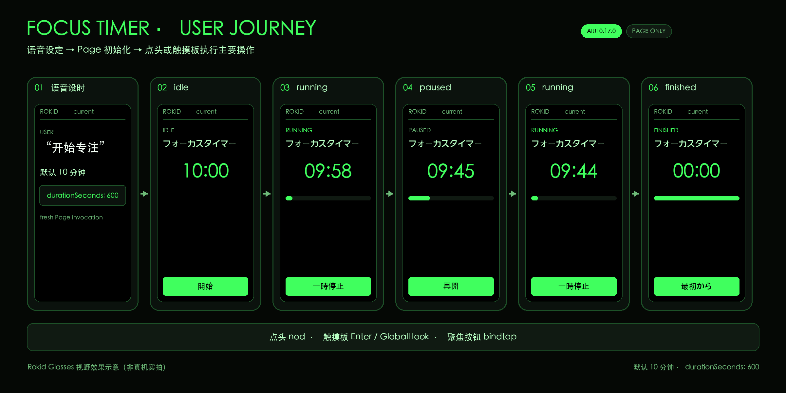

# ROKID AIUI Agent Skill

[](https://github.com/BreezeLife/rokid-aiui-agent-skill/actions/workflows/ci.yml)

[简体中文使用说明](docs/usage.zh-CN.md) | [English usage guide](docs/usage.en.md) | [日本語の使い方](docs/usage.ja.md)

这是面向 ROKID AIUI 的 Vibe Coding 快速开始：和 AI 一起写代码，从一句需求走到可导入、可检查、可继续编辑的完整工程，同时避免把浏览器或微信小程序经验误当成 AIUI 能力。

## 这个 Skill 能做什么

你可以用它完成以下 AIUI 开发任务：

- 创建完整、可编辑的 AIUI 项目
- 修改或扩展现有 AIUI 工程
- 审查并调试 AIUI 工程的项目结构、交互和版本兼容性
- 验证项目并交付可由 AIUI Studio 导入的源码目录；AIX 支持且真实打包成功时，额外交付已检查的 `.aix`

## 快速开始

根据你的起点选择一条开发路线。

### 路线 1：在 AIUI Studio 中打开项目

如果你已有完整的 AIUI 项目，无论工程位于本地还是 GitHub，都按[导入 AIUI Studio](#导入-aiui-studio)中的说明选择对应方式打开项目。
导入后可在 Studio 中继续编辑和开发。

如果想先体验本仓库唯一的产品化示例，可打开[内置 Focus Timer](#内置-focus-timer)。
导入坐标在后文统一维护，本节不重复列出。

### 路线 2：用 Codex 等 Vibe Coding 工具开发

Codex 只是一个示例；其他支持 Agent Skills、能访问项目工作区的编码工具也适用。
按以下五步创建或修改 AIUI 项目：

1. 安装 Skill。主安装命令需要在支持 Agent Skills 的编码环境终端运行：

   ```bash
   npx skills add BreezeLife/rokid-aiui-agent-skill --skill rokid-aiui-agent
   ```

   如果 `gh skill --help` 可用，也可以使用以下备用命令：

   ```bash
   gh skill install BreezeLife/rokid-aiui-agent-skill rokid-aiui-agent --agent codex --scope user
   ```

   Codex、Claude Code、Cursor 的安装范围、调用方式和当前 0.19 分支安装命令见[在 Vibe Coding 工具中使用](#在-vibe-coding-工具中使用)。

2. 打开独立工作区。在 Codex 或其他编码工具中，新建或打开一个独立工作区。该目录必须位于本 Skill 仓库之外。

3. 调用 Skill。先把示例路径 `/absolute/path/to/my_focus_timer` 替换为你自己的绝对输出目录，再把下面这段话交给编码智能体：

   ```text
   使用 $rokid-aiui-agent，为 Rokid Glasses 创建一个 AIUI 0.19.0 专注计时器。
   在独立输出目录 /absolute/path/to/my_focus_timer 中创建，不要把新 Agent
   写入本 Skill 仓库。
   支持语音设置时长，在 _current 和 _blank 中都保持清晰易用；完成后交付可由
   AIUI Studio 导入的完整源码目录；AIX CLI 支持并实际成功时，另在导入根之外
   输出 `.aix` 包。运行可用的自动检查，并明确列出仍需 Studio 或真机验证的项目。
   不要把未执行的检查写成已经通过。
   ```

4. 检查交付结果。确认主交付物是完整、可编辑的 AIUI 项目目录；若完整 AIX pack/list 与指纹校验成功，还应得到导入根之外的 `.aix` 路径、字节数、SHA-256 和清单结果。查看智能体已实际执行的检查与验证结果。尚未完成的 AIUI Studio 或 Rokid Glasses 验证必须保留为 `BLOCKED`。

5. 导入 AIUI Studio。选择包含 `app.json` 的交付目录本身，也就是准确输出根。按[导入 AIUI Studio](#导入-aiui-studio)继续验收。

你也可以把“专注计时器”换成其他需求，或要求审查和修复现有 AIUI 工程。新 Agent 仍应生成在本 Skill 仓库之外。

## 在 Vibe Coding 工具中使用

在工具中打开你的独立开发工作区，使用能够读写文件、运行终端命令的 Agent 模式。当前 [Skills CLI](https://github.com/vercel-labs/skills#install-a-skill) 要求 Node.js `22.20` 或更高版本；可先运行 `node --version` 检查。

上面的 `owner/repo` 安装命令读取仓库默认分支。当前 AIUI 0.19 更新位于 `feat/aix-deliverable`；试用该版本时使用下面的分支来源。以 Codex 为例，`--global` 安装到当前用户，使多个独立工程都可使用，技能文件也不会混进 Studio 导入根：

```bash
npx skills add 'BreezeLife/rokid-aiui-agent-skill#feat/aix-deliverable' --skill rokid-aiui-agent --agent codex --global
npx skills list --agent codex --global
```

第二条命令应列出 `rokid-aiui-agent`。Claude Code 或 Cursor 用户将两条命令中的 `codex` 替换为表中的安装参数；随后在聊天输入框中调用 Skill，再描述任务：

| 工具 | `--agent` 参数 | 调用与发现 |
| --- | --- | --- |
| Codex | `codex` | 在提示词中使用 `$rokid-aiui-agent`；CLI／IDE 扩展也可用 `/skills` 或输入 `$` 选择。[官方说明](https://learn.chatgpt.com/docs/build-skills#how-chatgpt-and-codex-use-skills) |
| Claude Code | `claude-code` | 输入 `/rokid-aiui-agent`，后接需求；输入 `/` 可查看技能菜单。[官方说明](https://code.claude.com/docs/en/skills) |
| Cursor | `cursor` | 在 Agent 聊天中输入 `/`，搜索并选择 `rokid-aiui-agent`，再填写需求。[官方说明](https://cursor.com/docs/skills#how-skills-work) |

其他支持 Agent Skills 的工具，使用安装器[支持的 agent 标识](https://github.com/vercel-labs/skills/blob/main/docs/agents.md)，按该工具的技能选择方式调用，也可以明确要求“使用 rokid-aiui-agent Skill”。安装列表中已有技能但工具尚未发现时，重新打开会话或重启工具，并确认安装与开发使用的是同一台机器和用户。

下面是 Codex 中可直接修改后发送的提示词。先将输出目录替换为你自己的绝对路径；Claude Code／Cursor 将第一行改为 `/rokid-aiui-agent` 或通过技能菜单选择后附上其余内容。

```text
$rokid-aiui-agent
在独立目录 /absolute/path/to/my_focus_timer 创建 AIUI 0.19.0 专注计时器。
支持语音设置时长、开始、暂停、继续与重置，覆盖 _current 和 _blank。
先读取 Skill 入口及相关参考，再实现完整可编辑、可供 AIUI Studio 导入的源码工程。
验证核心功能、异常恢复、生命周期，以及焦点、触摸和语音交互的 UX。
执行可用的本地检查；AIX pack/list 与源码指纹校验成功时，在导入根之外交付 .aix。
交付源码路径、实际执行结果、项目级 UX 表和逐能力表。
未执行的 Studio、平台或真机验证保留 BLOCKED，不把本地预览当作真机通过。
```

安装命令在终端运行，以上任务提示词在工具的聊天输入框发送。开始开发时让智能体说明已读取的 `SKILL.md` 路径，并核对其中的默认目标为 `0.19.0`；仅有安装成功提示还不能确认本次任务已加载该版本。

## 你会得到什么

创建或实现任务中，完整、可编辑的源码工程始终是必交付物，并以 AIUI 项目目录交付；其目录本身可直接作为 AIUI Studio 导入根，而不是一组零散代码或只有 `.aix` 包。

若选定 AIX CLI 的帮助明确提供 pack 与 list（或 `ls`），且真实打包和清单检查成功，Skill 默认同时在导入根之外交付一个 `.aix` 包。它是附加分发产物，不能取代源码，也不能作为 AIUI Studio 导入根。工具不可用时 AIX 交付保持 `BLOCKED`；已执行的打包或清单检查失败则记为 `FAIL`。

`app.json.pages` 声明的所有页面，以及这些页面引用的所有图片、样式和其他资源，都必须包含在交付目录中；缺少任何一项都不算完整工程。

典型目录如下：

```text
my-agent/
├── AGENTS.md
├── aiui-audit-claims.json
├── app.js
├── app.json
└── pages/
    └── index/
        └── index.ink
```

智能体还会说明目标版本、承载面、输入方式、已运行的检查，以及哪些 Studio 或设备项目仍待人工确认。

`_current` 是嵌入对话的承载面，`_blank` 是全屏承载面；`BLOCKED` 表示该项仍待验证，而不是已经通过。

## 导入 AIUI Studio

根据工程所在位置选择导入方式：

- 本地导入：选择包含 `app.json` 的源码交付目录本身，不要选择其中的页面或 `.aix` 打包产物。
- GitHub 导入：提供仓库、ref 和 AIUI 项目所在的子目录。内置示例可直接使用以下坐标：

```text
Repository: https://github.com/BreezeLife/rokid-aiui-agent-skill
Ref: main
Directory: skills/rokid-aiui-agent/assets/focus-timer-agent
```

本地检查不能替代 AIUI Studio 导入和 Rokid Glasses 真机验证。没有登录 Studio 或连接目标设备时，相应结果应明确保留为 `BLOCKED`。

## 内置 Focus Timer

[`skills/rokid-aiui-agent/assets/focus-timer-agent`](skills/rokid-aiui-agent/assets/focus-timer-agent/) 是随 Skill 安装的唯一产品化示例 Agent，也是一个完整的 AIUI Studio 导入根。

它是保留 AIUI `0.17.0` 兼容性的 Page-only 日文计时器，用于回归验证；新建项目的版本默认值不会自动升级这个示例。未指定时长时默认 10 分钟，也接受 1～3600 秒和可选标签。

源码和本地测试只验证收到主要操作事件后的状态映射：

| 计时器状态 | 收到事件后的操作 |
| --- | --- |
| 未开始 | 开始 |
| 进行中 | 暂停 |
| 已暂停 | 继续 |
| 已完成 | 重新开始 |

本地证据不能证明眼镜已发出对应事件。点头和触摸板仍需 Rokid Glasses 真机验证，状态为 `BLOCKED`。

对话中修改为新的时长会打开一个新 Page。语音触发仍需 AIUI Studio 和 Rokid Glasses 真机验证，状态同样为 `BLOCKED`。

该计时器不承诺后台持续运行、系统通知或持久化恢复。

### Focus Timer 开发者视觉参考



上图展示语音设时、默认 10 分钟、点头/触摸板开始、暂停、继续和完成流程。它是基于当前源码与 AIX 模拟器行为绘制的 Rokid Glasses 视野效果示意，不是真机实拍，也不替代 AIUI Studio 或物理眼镜验证。

[下载六页开发者 PDF](output/pdf/focus-timer-developer-reference.pdf)

## 自动检查

Skill 会根据当前工程运行结构验证、确定性业务逻辑测试，以及本机 AIX 实际支持的 preview、pack 和 list 流程。持久打包、最终清单与源码指纹校验全部成功时，会报告绑定的源码指纹、最终 `.aix` 绝对路径、字节数、SHA-256 和清单；它还要求项目级 UX 表与逐能力表，避免用一次浏览器预览代替 Studio 或真机结论。

完整命令与结果语义见三份语言指南；验收原则见 [UX 与能力测试](skills/rokid-aiui-agent/references/ux-and-capability-testing.md)。

## 版本边界

新建项目在没有明确版本时，Skill 默认以 AIUI `0.19.0` 为目标。已有工程和宿主明确指定的 `0.17.0`、`0.18.0` 等目标会保留，不自动升级；内置计时器和最小工程仍是 `0.17.0` 兼容性 fixture。

版本匹配的功能与验收边界见 [AIUI 0.19 指南](skills/rokid-aiui-agent/references/aiui-0.19.md) 和[官方 0.19.0 快速开始](https://open.rokid.com/aiui/guide/quickstart/intro?version=0.19.0&lang=en-US)。清单与审计工具接受 `0.19.0`，但该版本尚未注册独立的能力 PASS 策略，能力项仍为 `BLOCKED`；本地检查不能替代 Studio 或真机验收。

Skill 会先检查当前环境实际提供的 AIX 命令，不会假设不存在的创建、构建或部署流程。

## 仓库内容

仓库将 Skill、参考资料、检查工具和可导入示例分开存放：

| 路径 | 用途 |
| --- | --- |
| [`skills/rokid-aiui-agent/SKILL.md`](skills/rokid-aiui-agent/SKILL.md) | Skill 入口和任务流程 |
| [`skills/rokid-aiui-agent/references/`](skills/rokid-aiui-agent/references/) | 按需读取的 AIUI 开发参考 |
| [`skills/rokid-aiui-agent/scripts/`](skills/rokid-aiui-agent/scripts/) | 项目结构、能力和审计检查工具 |
| [`skills/rokid-aiui-agent/assets/studio-importable-minimal/`](skills/rokid-aiui-agent/assets/studio-importable-minimal/) | 可导入 AIUI Studio 的最小工程模板 |
| [`skills/rokid-aiui-agent/assets/focus-timer-agent/`](skills/rokid-aiui-agent/assets/focus-timer-agent/) | 仓库中唯一的产品化示例 Agent |
| [`docs/usage.zh-CN.md`](docs/usage.zh-CN.md)、[`docs/usage.en.md`](docs/usage.en.md) 和 [`docs/usage.ja.md`](docs/usage.ja.md) | 中文、英文和日文完整指南 |

## 深入指南

需要完整提示词、验证命令或规范细节时，按任务选择以下入口：

- [简体中文完整指南](docs/usage.zh-CN.md)：常见提示词、完整验证顺序、打包、Studio 导入与故障排查。
- [English guide](docs/usage.en.md)：the same end-to-end workflow in English.
- [日本語ガイド](docs/usage.ja.md)：同じ開発・検証フローの日本語版。
- [Skill 入口](skills/rokid-aiui-agent/SKILL.md)：任务路由、交付规则和按需参考资料。
- [来源优先级](skills/rokid-aiui-agent/references/source-of-truth.md)：官方版本、实现与示例发生冲突时的取舍原则。

## 来源与许可证

本项目以 AIUI 版本匹配的官方文档、实现和可运行示例为主要依据，并明确区分第三方材料。详细归属见 [THIRD_PARTY_NOTICES](THIRD_PARTY_NOTICES.md)。

代码以 [Apache License 2.0](LICENSE) 发布。未经真实执行的 AIUI Studio、平台或设备行为不会被写成已验证结论。
