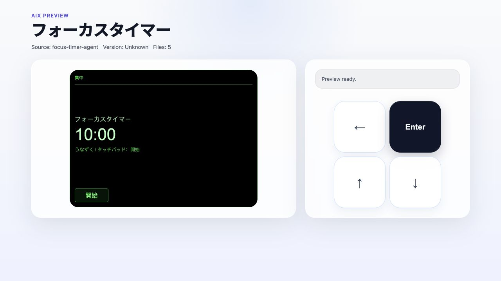

# Focus Timer 实际界面截图

README 的三张图于 **2026-10-24** 在浏览器中运行仓库内置 Focus Timer 后直接截取。只裁取完整画布区域，没有重绘界面、替换数字或修改应用源码。



## 来源与环境

- 源码：[内置 Focus Timer](../skills/rokid-aiui-agent/assets/focus-timer-agent/)，仓库提交 `0acb0b14a9a3c69572c726dd126076ca2d758c35`；截图时该目录无改动。
- 示例兼容目标：AIUI **0.17.0**。这与 Skill 为新项目默认选择 **0.19.0** 是不同范围。
- CLI：锁定的 `@yodaos-pkg/aix-cli@0.8.2`，使用原样导出的预览 HTML。
- 浏览器实际加载的模块：`https://esm.sh/@yodaos-pkg/ink@0.19.1/es2022/ink.mjs`，由浏览器控制台日志确认。没有使用诊断补丁或替换 SDK。
- 页面：`pages/index/index`，无查询参数，默认 600 秒；默认紧凑视图（`_current`），480 × 352 CSS 像素画布。
- [来源及文件校验记录](assets/focus-timer-preview/capture.json)保存源码、HTML 和截图的 SHA-256，以及捕获范围。

完整预览顶部的 `Version: Unknown` 是 AIX 从目录读取的包版本字段，不能用它判断 Ink 版本；以上运行时版本取自实际加载模块的日志。

## 实际操作

| 图片 | 操作与可见结果 |
| --- | --- |
| [idle.jpg](assets/focus-timer-preview/idle.jpg) | 原样打开预览；显示 `10:00`、`開始`。 |
| [running.jpg](assets/focus-timer-preview/running.jpg) | 点击预览器右侧 **Enter**；倒计时运行，截到 `09:54`、`一時停止`。 |
| [paused.jpg](assets/focus-timer-preview/paused.jpg) | 再点击 **Enter**；显示 `09:53`、`再開`。 |

数字来自实际经过的时间，不是固定的截图测试值。紧凑视图按源码隐藏进度条和完整状态说明，截图保留这一行为。

## 如何重新截图

在仓库根目录执行：

```bash
npm ci
node_modules/.bin/aix --help
node_modules/.bin/aix preview skills/rokid-aiui-agent/assets/focus-timer-agent \
  --html-out /tmp/focus-timer-preview.html
python3 -m http.server 8768 --bind 127.0.0.1 --directory /tmp
```

在浏览器打开 `http://127.0.0.1:8768/focus-timer-preview.html`，确认画布实际出现，再通过右侧 Enter 控件操作。截取完整画布，保留比例，并同时留存一张包含预览器上下文的全图。

AIX 0.8.2 的导出 HTML 使用未指定版本的 Ink 网络导入；同一份 CLI 锁文件不保证未来仍加载 0.19.1。每次重新截图都要记录实际加载的模块版本与源码身份，不能只沿用本次说明。

## 验证范围与旧资料

本次截图证明该源码在上述浏览器环境中的初始、开始和暂停画面。它们不证明 `_blank`、完成态、语音触发、点头识别、真实触摸板、Studio 导入或物理眼镜显示已通过，也不构成发布就绪证据。此前独立生成的 0.19 Agent 仍需按自己的证据重新验证。

旧的 [流程示意图](assets/focus-timer-user-journey.png)和[六页开发者 PDF](../output/pdf/focus-timer-developer-reference.pdf)保留为历史说明资料，已从 README 主展示移除。它们是绘制的示意，部分进度条、按钮样式与当前紧凑视图不一致，不应作为界面截图或当前验收证据使用。
